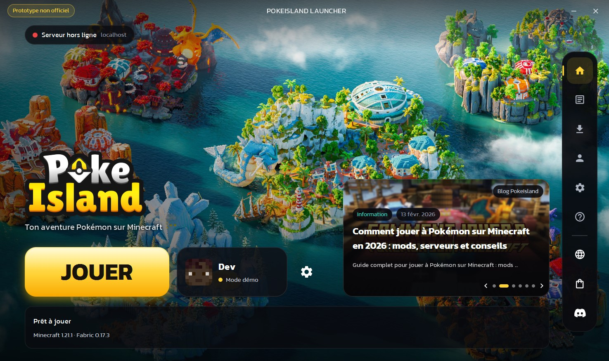
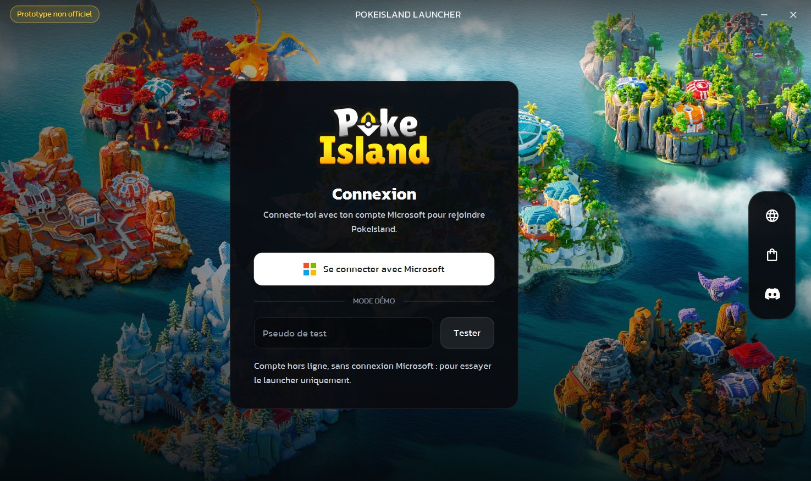
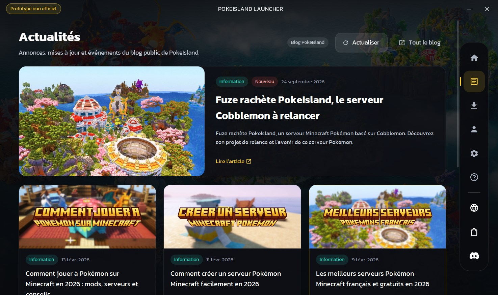
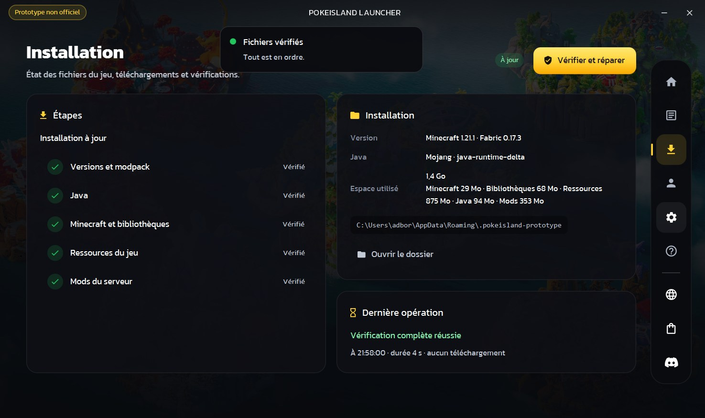
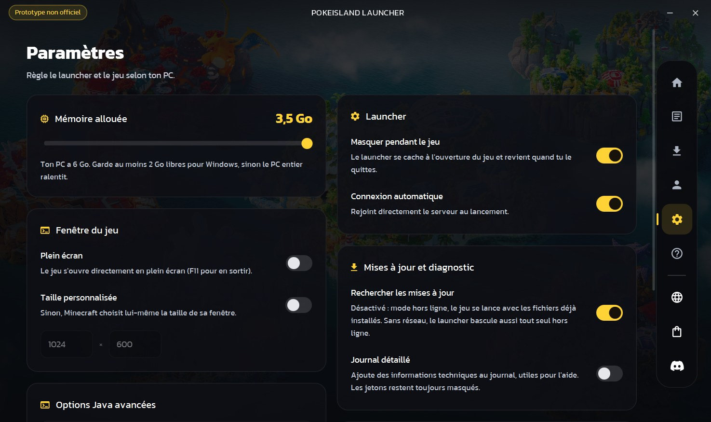
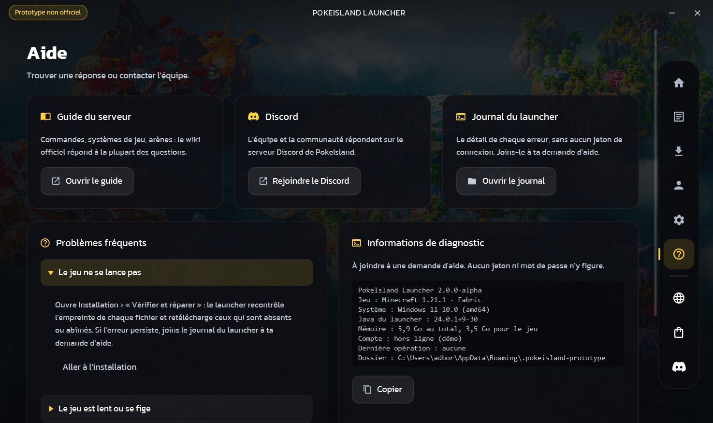

<div align="center">

# PokeIsland Launcher — prototype

**Un launcher Minecraft pensé pour le serveur PokeIsland : un bouton Jouer, et tout le reste se fait seul.**




<sub>Captures du launcher réel (version Windows empaquetée, 27/10/2026). Illustration et logo : © PokeIsland, affichés
pour la démonstration ; les fichiers ne sont pas fournis avec le code (voir <a href="#visuels-de-pokeisland">Visuels</a>).</sub>

</div>

> [!IMPORTANT]
> **Prototype non officiel**, réalisé dans le cadre d'une candidature de développeur. Il n'est ni édité, ni approuvé
> par PokeIsland, Mojang Studios ou Microsoft. La mention « Prototype non officiel » reste affichée en permanence
> dans la fenêtre.

## Sommaire

1. [Essayer le launcher](#essayer-le-launcher)
2. [Fonctionnalités : réelles et simulées](#fonctionnalités--réelles-et-simulées)
3. [Développement](#développement)
4. [Configuration](#configuration)
5. [Sécurité et données du joueur](#sécurité-et-données-du-joueur)
6. [Architecture](#architecture)
7. [Tests et mesures](#tests-et-mesures)
8. [Limitations connues](#limitations-connues)
9. [Améliorations possibles](#améliorations-possibles)
10. [Crédits et mentions légales](#crédits-et-mentions-légales)

---

## Essayer le launcher

**Version Windows (rien à installer)** : décompresse `PokeIsland-Launcher-2.0.0-alpha-windows.zip` (38 Mo), puis
lance `PokeIsland Launcher.exe`. Java est inclus dans le dossier.

L'archive se construit avec [`packaging/build-windows.ps1`](packaging/build-windows.ps1) (voir
[Développement](#développement)).

Au premier écran, choisis le **mode démo** : entre un pseudo de test (3 à 16 lettres, chiffres ou `_`) puis
« Tester ». La connexion Microsoft n'est pas activée dans ce prototype (voir [Limitations](#limitations-connues)).

Un clic sur **Jouer** installe alors, dans `%APPDATA%\.pokeisland-prototype` :

| Étape | Contenu | Taille |
|---|---|---|
| 1. Versions et modpack | profils Mojang + Fabric, manifeste du modpack | < 1 Mo |
| 2. Java | Java 21 officiel de Mojang (`java-runtime-delta`) | ~95 Mo |
| 3. Minecraft et bibliothèques | Minecraft 1.21.1, Fabric Loader 0.17.3 | ~100 Mo |
| 4. Ressources du jeu | sons, langues, textures (~3 900 fichiers) | ~875 Mo |
| 5. Mods du serveur | selon le `modpack.json` configuré (aucun par défaut) | — |

Les lancements suivants ne retéléchargent que ce qui a changé ; la vérification prend quelques secondes.

<table>
<tr>
<td width="50%"></td>
<td width="50%"></td>
</tr>
<tr>
<td align="center"><sub>Connexion : compte Microsoft (à activer) ou mode démo</sub></td>
<td align="center"><sub>Actualités : articles réels du blog pokeisland.fr</sub></td>
</tr>
<tr>
<td></td>
<td></td>
</tr>
<tr>
<td align="center"><sub>Installation : étapes, espace disque, vérification et réparation</sub></td>
<td align="center"><sub>Paramètres : mémoire, fenêtre du jeu, options Java validées</sub></td>
</tr>
<tr>
<td></td>
<td valign="middle"><sub><b>Aide</b> : problèmes fréquents, journal du launcher, informations de diagnostic à copier
(sans aucun jeton), liens vers le guide et le Discord.<br><br>Toujours visibles : la mention « Prototype non officiel »
et le rail de navigation, avec le site, la boutique et le Discord.</sub></td>
</tr>
</table>

---

## Fonctionnalités : réelles et simulées

### Opérationnelles

Toutes ont été essayées dans le vrai launcher, sauf mention contraire (\*).

| Domaine | Ce qui fonctionne |
|---|---|
| **Installation** | Minecraft 1.21.1 + Fabric 0.17.3 + Java 21 de Mojang, téléchargés en parallèle (24 connexions, threads virtuels), chaque fichier contrôlé par SHA-1, écrit d'abord dans un `.part` puis remplacé : jamais de fichier à moitié écrit |
| **Bouton Jouer** | 7 états réels (Prêt, Préparation, Téléchargement, Mise à jour, Lancement, En jeu, Erreur) déduits de ce qui se passe vraiment (octets reçus, fenêtre du jeu détectée) ; annulation à tout moment |
| **Lancement du jeu** | Ligne de commande Mojang complète (règles par système, arguments, bibliothèques natives), mémoire choisie, taille de fenêtre ou plein écran ; le launcher se cache pendant la partie et revient ensuite. Connexion directe au serveur configuré\* |
| **Vérifier et réparer** | Contrôle l'empreinte de chaque fichier et ne retélécharge que les fichiers abîmés ; ne touche **jamais** aux mondes, captures, options ou packs de ressources du joueur |
| **Hors ligne** | Si Internet coupe, le jeu déjà installé se lance quand même ; un fichier manquant est signalé clairement |
| **Réseau lent ou muet** | Un transfert sans aucune donnée pendant 30 s est abandonné puis retenté (3 essais) |
| **Actualités** | Lecture du blog public pokeisland.fr (titre, catégorie, date, image) ; copie locale réutilisée pendant 30 min et en cas de coupure |
| **Statut du serveur** | Ping Minecraft (en ligne, joueurs, latence) sur l'adresse configurée\* |
| **Modpack** | Synchronisation depuis un `modpack.json` (SHA-1 obligatoire, dossiers gérés limités à `mods`, `resourcepacks`, `shaderpacks`)\* ; outil de génération du manifeste essayé |
| **Paramètres** | Mémoire (bornée selon le PC), fenêtre du jeu, options Java filtrées, dossier du jeu, journal détaillé ; tout est validé avant enregistrement |
| **Aide** | Problèmes fréquents, accès au journal, informations de diagnostic à copier, liens Discord / guide / vote |
| **Fenêtre** | Une seule instance à la fois, coins arrondis et ombre natifs de Windows 11, navigation au clavier (Tab, Échap) |

\* Code en place et couvert par les tests, mais non essayé de bout en bout : le serveur configuré est `localhost` (seul
l'état « hors ligne » a donc été vu) et il n'existe pas de modpack public à synchroniser.

### Simulées ou désactivées (et affichées comme telles)

| Élément | État | Pourquoi |
|---|---|---|
| **Connexion Microsoft** | Code présent (Microsoft → Xbox Live → XSTS → Minecraft), **désactivé** | Il faut une application Azure approuvée par Mojang : `AZURE_CLIENT_ID` est vide. L'écran Compte l'indique (« Non activée dans ce prototype ») |
| **Compte de test** | Compte hors ligne, badge **DÉMO** | Permet d'essayer le launcher ; ne peut pas rejoindre un serveur en ligne |
| **Serveur** | `localhost:25565` | L'adresse réelle du serveur n'est pas intégrée sans l'accord de PokeIsland ; le statut affiche donc « Serveur hors ligne » |
| **Modpack** | Aucun par défaut (`MODPACK_URL` vide) | Le modpack officiel n'a pas de manifeste public ; le mécanisme est prêt et testé |
| **Actualités de démonstration** | Deux articles marqués **Démo** | Affichés seulement si le blog est injoignable **et** qu'aucune copie locale n'existe |

Aucune statistique (joueurs, temps de jeu…) n'est inventée : ce qui n'est pas mesuré n'est pas affiché.

---

## Développement

**Prérequis :** JDK 24 ou plus récent et Maven 3.9.

```powershell
mvn clean javafx:run          # lancer le launcher
mvn clean test                # 72 tests (une trentaine de secondes)
powershell -ExecutionPolicy Bypass -File packaging\build-windows.ps1 -Jdk "C:\Program Files\Java\jdk-24"
```

Le script de construction compile, lance les tests, assemble un Java réduit aux modules utilisés (`jlink`), crée
`target\dist\PokeIsland Launcher\` avec son `.exe` (`jpackage`), puis l'archive `.zip`. Le JDK indiqué doit contenir
le dossier `jmods`.

> [!TIP]
> Garde le `clean` : l'extension Java de VS Code compile parfois dans `target/classes` avec son propre compilateur,
> et `mvn javafx:run` seul lancerait alors des classes incomplètes (« Unresolved compilation problems »).

**Options Java du launcher** (mesurées, voir [Tests et mesures](#tests-et-mesures)) : `-XX:+UseSerialGC -Xmx256m`
plafonne la mémoire du launcher lui-même, pour en laisser davantage au jeu (son pic mesuré est de 88 Mo pendant une
installation complète). Elles ne concernent pas Minecraft, qui a son propre réglage dans les Paramètres. L'archive de démarrage (`-XX:+AutoCreateSharedArchive`) est créée à la
première fermeture et accélère les lancements suivants.

### Visuels de PokeIsland

Les visuels officiels (illustration de fond, logo) **ne sont pas dans le dépôt** : ils appartiennent à PokeIsland.
Sans eux, le launcher affiche un rendu complet de secours : logo typographique, fond dégradé. Pour une démonstration
privée, dépose `background.jpg` (ou `.png`) et `logo.png` dans l'un de ces dossiers :

- `branding\` à la racine du projet (ignoré par Git) ;
- `branding\` à côté de `PokeIsland Launcher.exe` ;
- `%APPDATA%\.pokeisland-prototype\launcher\branding\`.

Pour produire une archive de démonstration qui les contient déjà :

```powershell
powershell -ExecutionPolicy Bypass -File packaging\build-windows.ps1 -Jdk "C:\Program Files\Java\jdk-24" -Branding <dossier des visuels>
```

Elle s'appelle `PokeIsland-Launcher-2.0.0-alpha-windows-demo.zip`. Elle est destinée à être montrée à l'équipe de
PokeIsland, pas à être diffusée publiquement.

Les images sont décodées à leur taille d'affichage : une illustration en 4K ne coûte pas plus de mémoire.

---

## Configuration

Tout se règle dans [`LauncherConfig.java`](src/main/java/fr/launcher/LauncherConfig.java) :

| Constante | Rôle | Valeur |
|---|---|---|
| `MINECRAFT_VERSION` · `FABRIC_LOADER` | Versions figées, relevées dans l'installation officielle | `1.21.1` · `0.17.3` |
| `SERVER_HOST` · `SERVER_PORT` | Serveur pour le statut et la connexion directe | `localhost` · `25565` |
| `MODPACK_URL` | Adresse du `modpack.json` (vide = sans mods) | vide |
| `AZURE_CLIENT_ID` | Application Microsoft (vide = connexion désactivée) | vide |
| `DEV_MODE` | Autorise le compte de test | `true`, à passer à `false` avant toute distribution |
| `DIR_NAME` | Dossier de données | `pokeisland-prototype` (jamais `pokeisland`, le dossier officiel) |
| `*_URL` · `TRUSTED_HOSTS` | Liens publics et seuls domaines ouvrables depuis le launcher | pokeisland.fr, Discord, YouTube, TikTok… |

### Publier un modpack

```powershell
mvn clean compile
java -cp target\classes fr.launcher.tools.ManifestGenerator <dossier> https://ton-site.fr/modpack/ 1.21.1 0.17.3
```

`<dossier>` reprend la structure du jeu (`mods\`, éventuellement `resourcepacks\`, `shaderpacks\`, `config\`). L'outil
écrit `modpack.json` (chemin, URL, SHA-1 et taille de chaque fichier) ; envoie le dossier en ligne et mets l'URL du
manifeste dans `MODPACK_URL`. Un fichier en trop dans un dossier géré est retiré ; un fichier sans SHA-1 ou visant
un chemin protégé (`saves`, `options.txt`…) est refusé.

### Activer la connexion Microsoft

1. Portail Azure → *App registrations* → *New registration*, comptes Microsoft personnels uniquement.
2. *Authentication* → activer *Allow public client flows* (connexion par code, sans URL de redirection).
3. Copier l'*Application (client) ID* dans `AZURE_CLIENT_ID`.
4. Demander à Mojang l'accès à l'API Minecraft pour cette application (formulaire des applications tierces).

Le joueur saisit un code sur microsoft.com/link : le launcher ne voit jamais son mot de passe.

---

## Sécurité et données du joueur

- **Aucun mot de passe stocké.** La session Microsoft est chiffrée avec la DPAPI de Windows (liée à la session de
  l'utilisateur) dans `account.dat` ; un ancien fichier en clair est migré puis supprimé.
- **Jetons jamais journalisés.** Chaque ligne du journal passe par un filtre qui masque JWT, jetons Xbox, `--accessToken`
  et en-têtes `Bearer` (couvert par des tests).
- **Aucun secret dans le code client.** L'identifiant Azure est public par nature (client public, sans secret).
- **Rien d'exécuté à l'aveugle.** Chaque fichier téléchargé est vérifié par SHA-1 ; le modpack ne peut écrire que dans
  `mods`, `resourcepacks` et `shaderpacks` ; les options Java du joueur sont filtrées (`-javaagent`, `-XX:OnError`… refusés).
- **Liens limités** aux domaines de confiance listés dans `TRUSTED_HOSTS`.
- **Dossier officiel intouché.** Le prototype refuse d'utiliser `%APPDATA%\.Pokeisland` (comparaison insensible à la casse,
  comme Windows) et n'y lit rien à l'exécution.
- **La réparation ne supprime ni les mondes ni les réglages** : seuls les fichiers gérés par le launcher sont remplacés.

Données du launcher : `%APPDATA%\.pokeisland-prototype\launcher\` (préférences, compte chiffré, journaux tournants
de 2 Mo, cache des actualités).

---

## Architecture

```
src/main/java/fr/launcher
├── LauncherConfig.java        identité, versions, serveur, liens
├── core/                      logique sans interface (testable seule)
│   ├── auth/                  Microsoft → Xbox → XSTS → Minecraft, stockage chiffré (DPAPI)
│   ├── download/              téléchargements parallèles, SHA-1, reprise, chien de garde
│   ├── game/                  versions Mojang/Fabric, Java, ressources, lancement, suivi du jeu
│   ├── modpack/               synchronisation encadrée du modpack
│   ├── news/                  blog pokeisland.fr → copie locale → démo
│   ├── server/                ping Minecraft (Server List Ping)
│   ├── settings/              préférences validées, options Java, dossier du jeu
│   └── log/                   journal avec masquage des jetons
├── ui/                        JavaFX
│   ├── shell/                 fenêtre, barre de titre, rail de navigation, routeur, fond
│   ├── screens/               Connexion · Accueil · Actualités · Installation · Compte · Paramètres · Aide
│   ├── components/            bouton Jouer, carrousel, notifications, interrupteur…
│   └── theme/                 thème (CSS), police Kanit, visuels facultatifs
└── tools/ManifestGenerator    génération du modpack.json
```

Le style est entièrement en CSS ([`assets/css`](src/main/resources/fr/launcher/assets/css)) avec des couleurs nommées
(`theme.css`). Les écrans sont construits à la première visite. L'audit initial de l'ancien launcher est dans
[`AUDIT.md`](AUDIT.md).

---

## Tests et mesures

**72 tests automatisés, tous réussis** (`mvn clean test`), sans accès à Internet : les tests réseau utilisent un petit
serveur HTTP local.

| Domaine | Tests | Ce qui est vérifié |
|---|---|---|
| Téléchargements | 11 | transfert et SHA-1, fichier corrompu refusé sans résidu, annulation en plein transfert, serveur muet abandonné puis retenté, hors ligne, réparation d'un fichier abîmé, erreur 404 |
| Jeu | 14 | règles Mojang, arguments, résolution des versions, rotation des journaux du jeu, détection de la fenêtre du jeu |
| Compte et journal | 12 | chiffrement DPAPI, fichier abîmé, migration depuis le clair, masquage des jetons |
| Modpack | 6 | chemins protégés, dossiers gérés, SHA-1 obligatoire |
| Actualités | 10 | lecture du blog, copie récente réutilisée, repli cache puis démo |
| Paramètres | 13 | valeurs bornées, options Java refusées, dossier officiel refusé |
| Interface | 3 | démarrage réel de la fenêtre et des 7 écrans sans erreur, formats d'affichage |
| Utilitaires | 3 | JSON, détection du système |

**Mesures** (Windows 11, même machine, moyenne de plusieurs lancements) :

| Mesure | Avant optimisation | Après |
|---|---|---|
| Ouverture de la fenêtre | 4,0 – 4,4 s | 3,3 – 3,7 s |
| Démarrage interne (journal) | ~2,3 s | ~1,6 s |
| Mémoire privée du processus | ~350 Mo | ~260 Mo |
| Vérification complète, jeu à jour | — | ~5,5 s en ligne, ~15 s hors ligne (fichiers contrôlés un par un) |
| Processeur au repos | — | 0,5 – 0,65 % (carrousel en pause sans focus) |

**Version Windows vérifiée de bout en bout** (27/10/2026, PC de 6 Go) : archive décompressée dans un dossier neuf,
dossier de données vierge, mode démo, puis Jouer.

| Étape | Résultat |
|---|---|
| Premier lancement / lancements suivants | fenêtre prête en 4,0 s / 1,4 s (archive de démarrage créée à la première fermeture) |
| Installation complète depuis zéro | 9 min 42 s (~1 Go à ~1,5 Mo/s), puis Minecraft 1.21.1 + Fabric lancé, fenêtre détectée |
| Fin de partie | jeu fermé (code 0), launcher revenu à l'état Prêt |
| Hors ligne (réseau bloqué) | démarrage, actualités en copie locale et vérification complète sans erreur |
| Mémoire du launcher pendant l'installation | pic de 88 Mo dans un tas plafonné à 256 Mo (données vivantes : 62 Mo au plus) |
| Dates françaises | « 13 févr. 2026 » : données de langue incluses dans le Java embarqué |

---

## Limitations connues

- **Connexion Microsoft non activée** : faute d'application Azure approuvée par Mojang, seul le compte de test
  (hors ligne) est utilisable ; il ne peut pas rejoindre un serveur en ligne.
- **Serveur et modpack non branchés** : l'adresse du serveur et le modpack officiel ne sont pas intégrés sans
  autorisation. Le jeu installé est donc Minecraft + Fabric, sans les mods de PokeIsland.
- **Windows d'abord** : le chiffrement du compte (DPAPI) et la fenêtre native ciblent Windows 11. Le code prévoit
  macOS et Linux (dossiers, Java de Mojang) mais n'y a pas été essayé.
- **Pas d'installateur** : la version Windows est un dossier à décompresser (un installateur `.exe`/`.msi` demanderait
  l'outil WiX). Si ce dossier est placé dans `Program Files`, l'archive de démarrage rapide ne peut pas être écrite :
  le launcher fonctionne, un peu moins vite.
- **Actualités** : elles dépendent de la structure HTML du blog ; si elle change, le launcher se rabat sur la copie
  locale puis sur la démo, sans planter.
- **Mise à jour du launcher lui-même** non gérée : une nouvelle version se télécharge à la main.
- **Vérification hors ligne plus lente** (~15 s contre ~5,5 s en ligne) : sans réseau, les fichiers sont contrôlés un par
  un au lieu d'en parallèle.

## Améliorations possibles

- Activer la connexion Microsoft (application Azure + validation Mojang) et plusieurs comptes.
- Brancher le serveur et un `modpack.json` officiel, avec un canal de mise à jour signé.
- Mise à jour automatique du launcher, avec vérification de signature.
- Installateur Windows signé (WiX ou MSIX) et versions macOS / Linux testées.
- Présence Discord (« En jeu sur PokeIsland »), actualités via une API plutôt que le HTML du blog.
- Tests d'interface automatisés plus poussés (parcours complet connexion → Jouer).

---

## Crédits et mentions légales

- Police [Kanit](https://fonts.google.com/specimen/Kanit) — [SIL Open Font License](src/main/resources/fr/launcher/assets/fonts/OFL.txt).
- Têtes de joueurs via [mc-heads.net](https://mc-heads.net) ; [Gson](https://github.com/google/gson) (Apache 2.0) ;
  [OpenJFX](https://openjfx.io) (GPL v2 + Classpath Exception) ; [Fabric](https://fabricmc.net) pour le chargeur de mods.
- Icône du launcher : monogramme original ([`packaging/make-icon.ps1`](packaging/make-icon.ps1)).

PokeIsland, son logo et ses visuels appartiennent à leurs auteurs. Minecraft est une marque de Mojang AB ; ce projet
n'est pas affilié à Mojang Studios ni à Microsoft.
