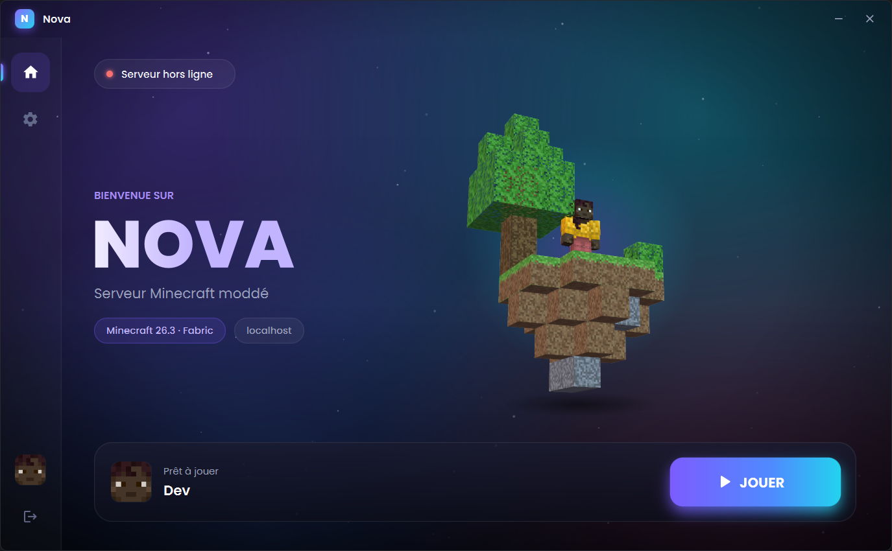
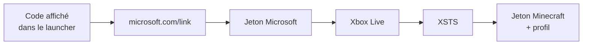
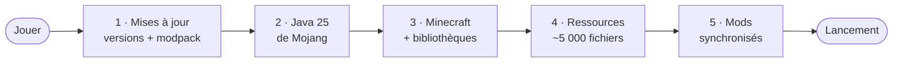

<div align="center">

# ✦ Nova Launcher

**Le launcher Minecraft moderne pour notre serveur moddé.**<br>
Connexion Microsoft, installation en un clic, mods toujours à jour, et une interface qui donne envie de jouer.

<br>


<br>



<sub>Le joueur, avec son vrai skin, en 3D sur une île flottante. La tête suit la souris, et l'île tourne quand on la fait glisser.</sub>

</div>

<br>

## ✨ Fonctionnalités

<table>
<tr>
<td width="50%" valign="top">

### 🎮 Pour les joueurs
- **Un seul bouton « Jouer »** : Minecraft, Fabric, Java et les mods s'installent tout seuls
- **Connexion Microsoft sécurisée** : le joueur entre un code sur microsoft.com/link, le launcher ne voit jamais son mot de passe
- **Connexion directe au serveur** au lancement du jeu
- **Statut du serveur en direct** : en ligne ou non, joueurs connectés, latence
- **Réglage de la mémoire** adapté automatiquement au PC
- **Le launcher se cache** pendant la partie et revient à la fermeture du jeu

</td>
<td width="50%" valign="top">

### 🎨 L'interface
- **Personnage 3D** avec le vrai skin du joueur (classique, fin « Alex » ou ancien format)
- **Île flottante en blocs**, textures pixel art générées par le code
- **Fond « aurore » animé** qui réagit à la souris (effet de profondeur)
- **Titre traversé par un reflet**, bouton Jouer avec un halo qui respire
- **Transitions fluides** entre les pages, notifications qui glissent
- **Fenêtre native Windows 11** : coins arrondis et ombre dessinés par le système

</td>
</tr>
<tr>
<td width="50%" valign="top">

### 🧩 Pour l'admin du serveur
- **Modpack synchronisé** : un fichier `modpack.json` en ligne, et tous les joueurs ont exactement les mêmes mods
- **Anti-mods en trop** : tout `.jar` absent du modpack est retiré du dossier `mods/`
- **Outil de génération** du `modpack.json` inclus
- **Tout se configure dans un seul fichier**

</td>
<td width="50%" valign="top">

### ⚡ Sous le capot
- **Téléchargements parallèles** sur des threads virtuels Java 21+
- **Vérification SHA-1** de chaque fichier, et réessai automatique en cas d'erreur
- **Java officiel de Mojang** installé automatiquement (Java 25 pour 26.x)
- **Mode hors-ligne** : réutilise les fichiers déjà installés si Internet coupe
- **Environ 3 % de processeur** au repos, rien du tout pendant le jeu

</td>
</tr>
</table>

<br>

## 🚀 Démarrage rapide

> **Prérequis :** [JDK 24+](https://adoptium.net) et [Maven](https://maven.apache.org). Les joueurs, eux, n'ont rien à installer.

```bash
git clone https://github.com/ISynn/minecraft-launcher.git
cd minecraft-launcher
mvn javafx:run
```

En mode développeur, tu peux entrer un pseudo de test pour essayer le launcher sans compte Microsoft.

<br>

## ⚙️ Configuration

Tout se règle dans [`LauncherConfig.java`](src/main/java/fr/launcher/LauncherConfig.java) :

| Constante | Rôle | Valeur actuelle |
|---|---|---|
| `NAME` · `TAGLINE` | Nom et slogan affichés | `Nova` · `Serveur Minecraft moddé` |
| `SERVER_HOST` · `SERVER_PORT` | Serveur pour le statut et la connexion directe | `localhost` · `25565` |
| `MINECRAFT_VERSION` | Version de Minecraft | `26.3` |
| `FABRIC_LOADER` | Version de Fabric (vide = dernière stable) | *vide* |
| `MODPACK_URL` | Adresse du `modpack.json` (vide = sans mods) | *vide* |
| `AZURE_CLIENT_ID` | Identifiant de l'application Microsoft | *à renseigner* |
| `DEV_MODE` | Autorise le compte de test hors-ligne | `true` → **`false` avant de distribuer** |

> 🖼️ **Image de fond personnalisée :** dépose `background.png` (ou `.jpg`) dans `src/main/resources/fr/launcher/assets/images/`. Elle s'affiche sous les halos animés.

<br>

## 🔐 Connexion Microsoft

<details>
<summary><b>Créer l'application Azure (gratuit, 5 minutes)</b></summary>

<br>

1. Ouvre le [portail Azure](https://portal.azure.com) → **App registrations** → **New registration**.
   - Type de compte : *Personal Microsoft accounts only*.
   - Pas d'URL de redirection.
2. Dans **Authentication**, active **Allow public client flows**.
3. Copie l'**Application (client) ID** dans `AZURE_CLIENT_ID`.
4. Demande à Mojang l'accès à l'API Minecraft pour cette application, via le formulaire de vérification des applications tierces.

> ⏳ La validation par Mojang peut prendre quelques jours. D'ici là, la connexion affiche « Application Azure pas encore autorisée par Mojang ».

</details>

Le chemin complet de la connexion :



<br>

## 📦 Ajouter des mods

**1. Prépare un dossier** avec la même structure que le dossier du jeu :

```
modpack/
├── mods/      ← tes .jar Fabric
└── config/    ← leurs configurations (optionnel)
```

**2. Génère le manifeste :**

```bash
mvn compile
java -cp target/classes fr.launcher.tools.ManifestGenerator modpack https://ton-site.fr/modpack/ 26.3
```

**3. Envoie le dossier en ligne** (avec le `modpack.json` généré), puis mets l'adresse de ce fichier dans `MODPACK_URL`.

À chaque clic sur **Jouer**, voici ce qui se passe :



Seuls les fichiers nouveaux ou modifiés sont téléchargés. Une fois tout installé, la vérification ne prend que quelques secondes.

<br>

## 🏗️ Architecture

```
src/main/java/fr/launcher
├── LauncherConfig.java      ⚙️  toute la personnalisation
├── core/                    🧠  logique pure, sans interface
│   ├── auth/                    Microsoft → Xbox → XSTS → Minecraft
│   ├── download/                téléchargements parallèles + SHA-1
│   ├── game/                    versions Mojang/Fabric, Java, assets, lancement
│   ├── modpack/                 synchronisation des mods
│   ├── server/                  ping du serveur (Server List Ping)
│   └── settings/                préférences du joueur
├── ui/                      🎨  JavaFX
│   ├── components/              fond animé, interrupteur, notifications…
│   ├── three/                   scène 3D : skin, île, textures pixel art
│   └── views/                   Connexion · Accueil · Paramètres
└── tools/                   🛠️  ManifestGenerator
```

<details>
<summary><b>Choix techniques et optimisations</b></summary>

<br>

| Problème | Solution |
|---|---|
| Une fenêtre transparente coûte environ 3× plus de processeur sous Windows | Fenêtre opaque. Les coins arrondis et l'ombre viennent de Windows 11 (DWM), appelé via l'API *Foreign Function* de Java, sans bibliothèque externe |
| Les ombres sont recalculées à chaque image du fond animé | Les éléments qui ont une ombre sont mis en cache sous forme d'image |
| Des milliers de petits fichiers à télécharger | Threads virtuels et sémaphore (24 connexions à la fois) |
| Revérifier 5 000 ressources à chaque lancement | Les ressources sont nommées par leur propre empreinte : vérifier leur taille suffit |
| Les textures 3D floutées par le GPU | Textures agrandies 8× en « plus proche voisin » : les pixels restent carrés |
| Des centaines de cubes à dessiner | Seules les faces visibles sont générées, dans un seul maillage |
| L'animation du fond est coûteuse | 30 images par seconde, et pause quand la fenêtre est réduite |

</details>

<br>

## 🗺️ Feuille de route

- [x] Connexion Microsoft
- [x] Installation de Minecraft, Fabric et Java
- [x] Synchronisation du modpack
- [x] Joueur 3D et île flottante
- [ ] Installateur `.exe` pour les joueurs
- [ ] Cycle jour/nuit sur l'île selon l'heure réelle
- [ ] Panneau d'actualités du serveur
- [ ] Plusieurs comptes
- [ ] Affichage « en jeu » sur Discord
- [ ] Logo et identité visuelle définitifs

<br>

## 🙏 Crédits

- Police [Poppins](https://fonts.google.com/specimen/Poppins) — licence [SIL Open Font License](src/main/resources/fr/launcher/assets/fonts/OFL.txt)
- Skins et avatars via [mc-heads.net](https://mc-heads.net)
- Icônes inspirées de [Material Symbols](https://fonts.google.com/icons)
- [Fabric](https://fabricmc.net) pour le chargeur de mods

<br>

<div align="center">
<sub>Projet indépendant, non affilié à Mojang Studios ni à Microsoft. Minecraft est une marque de Mojang AB.</sub>
</div>
